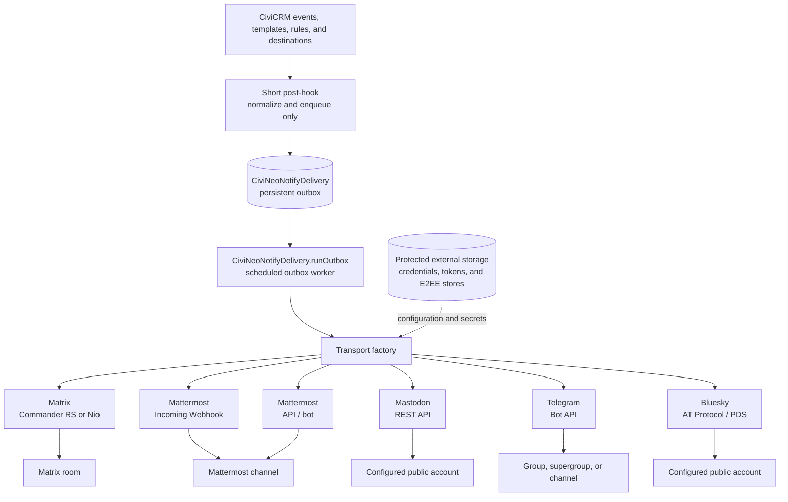

# Architecture

CiviNeo Notify is a rule-based outbound notification extension. Its CiviCRM
entities model **transports** (an account or sending mechanism), named
**destinations** (a room, channel, chat, or neutral account target), rules, and
a persistent delivery outbox. One event may match multiple rules and therefore
be delivered independently through multiple transports.

`hook_civicrm_post` is deliberately narrow: it normalizes a CiviCRM change,
evaluates active rules, renders an allowlisted-token message, and materializes
one `CiviNeoNotifyDelivery` record per resolved transport and destination. It
never opens a process or network connection.

The scheduled worker is the only component permitted to send. It selects due
pending or retry deliveries, verifies that their transport and destination are
active, and uses the transport factory to dispatch the message. Stable
correlation and transaction IDs are persisted before sending. The worker records
success, failure, retry timing, and `delivery_unknown` outcomes in the delivery
log. A failed delivery does not block other queued deliveries.

`CiviNeoNotifyDelivery.runOutbox` is a CiviCRM 6.16-compatible API v4
scheduled-job Action. The managed job supplies its `version=4` parameter and
the Action is a narrow entry point to the worker; the administrative UI and
manual tests also use API v4 actions. Retrying an entry returns it to `pending`;
the worker processes its selected batch sequentially.

Secrets are never stored in CiviCRM transport or destination records. A global
protected-storage-directory setting provides the default location for
transport-specific external token files, Matrix credentials, and E2EE stores.
Destinations contain only non-secret addressing data. Matrix provisioning and
verification remain isolated background-job workflows as documented in
[provisioning](provisioning.md).

The message-template resolver boundary is `rule → event default (reserved) →
entity default (reserved) → global setting`. Rules may select a destination
directly, or select a transport and use its active default destination. Inbound
commands are deliberately not implemented; see `inbound-roadmap.md`.

## Matrix client strategy

`matrix-commander-rs` remains a supported Matrix transport implementation for
installations with sufficient memory for its initial E2EE device synchronisation.
It is not the only intended implementation. An isolated `matrix-nio` E2EE
integration successfully created a device,
persisted a store, completed Element SAS verification, and delivered an
encrypted test notification within a 350 MiB service limit, where
matrix-commander-rs was OOM-killed. Matrix-Nio remains an alpha transport until
its pinned runtime and interoperability patches are independently reproducible
as a releaseable external deployment artifact.

The integration sends a targeted verification request to Element, waits for
the matching ready event, compares the same SAS on both sides, persists local
trust for the verified Element device, and sends the terminal verification
event. Its raw request/ready compatibility workaround, remaining upstream work,
and release criteria are documented in
[matrix-nio-limitations.md](matrix-nio-limitations.md).

Matrix-Nio refuses by default to share message keys with unverified recipient
devices. This Matrix transport retains that safe default and exposes any
`allow unverified recipient devices` setting as an explicit, documented
administrator choice. It does not replace verification of the persistent bot
device itself.

## Compatibility evidence

The reference runtime is CiviCRM 6.16+ with PHP 8.1–8.4 and
`matrix-commander-rs` 0.11.0. The verified CLI supports credentials/store
paths, stdin message input, rooms, timeouts and JSON output; it exposes no
explicit transaction-ID option, so timeout-after-send is `delivery_unknown`.
